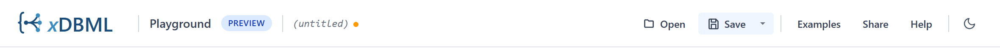

# Header bar & menus

The header bar sits across the top of the playground and stays visible at all times. It hosts the xDBML logo, the playground title, the name of the open file, and the action buttons: Open, Save, Examples, Share and Help. The last button switches between light and dark mode.

## The logo

The xDBML logo on the left links back to the main site at [xdbml.org](https://xdbml.org). Useful when you've landed in the playground from somewhere else and want to see the broader site.

## Open and Save

Click **Open** to load an `.xdbml` file from your computer into the editor, and **Save** to write the current schema to a file. The arrow next to **Save** opens more save options. The name of the open file is shown next to the playground title, with an amber dot when there are unsaved changes. See [**Open and save files**](./open-and-save-files).

## Examples

Click **Examples** to open a dropdown with the bundled sample schemas. Selecting one replaces the editor's current content with that example. A checkmark next to one of the entries indicates which example is currently loaded (when the editor's content matches an example).

The first six examples are:

- **Blog**: a small relational schema with users, posts, and comments. Good starting point for anyone familiar with traditional databases.
- **E-commerce**: a polyglot example that combines an Oracle container with a MongoDB orders container, demonstrating cross-engine references.
- **IoT telemetry**: a time-series oriented schema with high-volume sensor readings, illustrating denormalization patterns.
- **Social graph**: a graph-database example using Neo4j-style edges between Person nodes.
- **Healthcare (FHIR)**: a complex schema based on the FHIR resource model, showing nested objects, polymorphism, and `0..*` optional cardinality patterns.
- **Financial services**: the largest of these six, demonstrating multiple containers, views, and reference data.

The later examples each show one feature of the language, such as modules, supertype groups, constraints, diagram views and data lineage.

For more on the examples, including links to per-example write-ups that explain the modeling choices, see [**Loading examples**](./loading-examples).

## Share

Click **Share** to open a dropdown that contains a copyable URL encoding your current schema. The URL works in any browser, no account needed; pasting it loads the schema into a fresh playground session.

The dropdown shows:

- The full URL in a read-only text field (selectable so you can copy with the keyboard).
- A **Copy** button that copies the URL to your clipboard and briefly turns green to confirm.
- The URL's size, and a warning when it exceeds 4,000 characters (some chat apps truncate URLs that long).

Detailed coverage in [**Sharing via URL**](./sharing-via-url).

## Help

Opens this help section in a new browser tab. The new tab keeps your work intact in the original tab.

## Light and dark mode

The last button in the header switches the playground between light and dark mode. The playground starts in the mode of your operating system, and it remembers your choice.

## What's next

- [**Editor pane**](./editor-pane): how to use the editor itself.
- [**Loading examples**](./loading-examples): more on the bundled sample schemas.
- [**Sharing via URL**](./sharing-via-url): full details on how URL sharing works.
