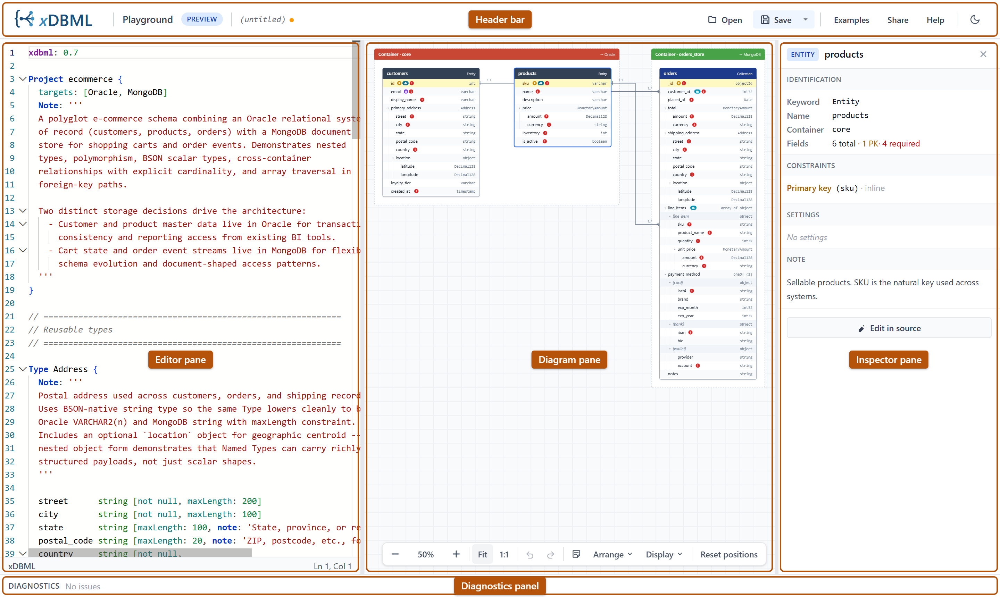

# Layout overview

The playground's main window has five regions: the header bar across the top, three resizable panes in the middle (editor, diagram, inspector), and the diagnostics panel across the bottom.

## The header bar

A thin strip at the top with the xDBML logo on the left and the action buttons on the right (Open, Save, Examples, Share, Help), followed by the button that switches between light and dark mode. Always visible, always the same height. Covered in detail in [**Header bar & menus**](./header-bar).

## The editor pane (left)

Your xDBML source code lives here. Backed by the [Monaco editor](https://microsoft.github.io/monaco-editor/), the same editor that powers VS Code, so you get syntax highlighting, find-and-replace, multi-cursor, and the editing affordances you'd expect. Covered in [**Editor pane**](./editor-pane).

The editor pane can be resized by dragging its right edge. It has a minimum width so it stays usable.

## The diagram pane (center)

The rendered diagram of your schema. Always takes the remaining horizontal space between the editor pane on its left and (when visible) the inspector pane on its right. Covered in [**Diagram pane**](./diagram-pane).

## The inspector pane (right)

Appears when you've selected something in the diagram. Hidden when nothing is selected, or when you explicitly close it via the × button on its header. Covered in [**Inspector pane**](./inspector-pane).

The inspector pane can be resized by dragging its left edge. When hidden, the diagram pane expands to fill the freed space.

## The diagnostics panel (bottom)

A bottom strip that lists parse errors and warnings. Always visible. The header bar of the panel shows "No issues" or a count; the body expands to list each issue with line and column. Covered in [**Diagnostics panel**](./diagnostics-panel).

## Layout state is remembered

The playground remembers your layout choices across reloads:

- **Editor pane width**
- **Inspector pane width**
- **Whether the inspector is open or explicitly closed**
- **Whether the diagnostics body is expanded or collapsed**

All four are stored in your browser's local storage. Clear your site data to reset to the default layout.

## What's next

To explore each pane in detail, head to [**Header bar & menus**](./header-bar) and follow the links from there. Or jump straight to a specific pane:

- [**Editor pane**](./editor-pane)
- [**Diagram pane**](./diagram-pane)
- [**Inspector pane**](./inspector-pane)
- [**Diagnostics panel**](./diagnostics-panel)
